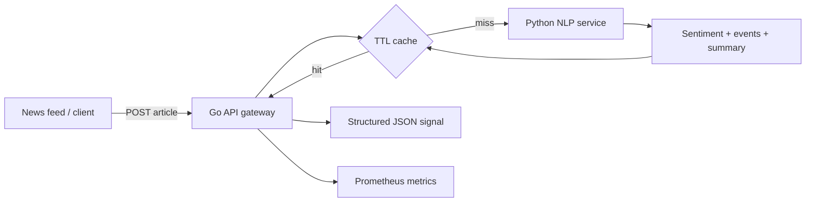

# MarketPulse AI

MarketPulse AI turns unstructured financial news into structured, API-ready signals in real time. A request containing an article produces a concise summary, sentiment score, confidence, ticker, and detected market events such as earnings, guidance changes, M&A, or regulatory action.

This project is a production-minded prototype built for a short technical walkthrough. It demonstrates the boundary between a low-latency Go delivery layer and an independently deployable Python inference layer.

## Architecture



Why this split:

- Go handles the hot path: concurrent requests, strict validation, bounded payloads, timeouts, caching, and operational metrics.
- Python keeps ML experimentation fast and exposes a model-agnostic contract. The explainable baseline can be replaced by FinBERT, a fine-tuned transformer, or an LLM without changing the public API.
- Content-addressed caching avoids duplicate inference when syndication produces the same article more than once.

## Run it

```bash
docker compose up --build
make demo
make demo  # second call returns X-Cache: HIT
curl http://localhost:8080/metrics
```

Example response:

```json
{
  "article_id": "benzinga-demo-001",
  "ticker": "LLY",
  "sentiment": "positive",
  "score": 0.9336,
  "events": ["earnings", "guidance_change"],
  "summary": "Eli Lilly beats Q1 earnings estimates and raises full-year guidance. Revenue growth was strong after record demand for its diabetes and obesity portfolio.",
  "confidence": 0.9501,
  "model": "financial-lexicon-baseline-v1"
}
```

## Production evolution

The baseline deliberately favors deterministic, inspectable behavior for the demo. The next production increments would be: Kafka ingestion with article-ID idempotency; FinBERT sentiment and a fine-tuned event classifier; OpenSearch kNN for related-news retrieval; Redis distributed caching; model/version metrics and shadow evaluation; and EKS autoscaling based on queue depth and inference latency.

## Design decisions and tradeoffs

- **Stable inference boundary:** model changes stay inside Python while clients keep the same Go API.
- **Fail fast:** the Go client has a three-second timeout and maps upstream failures to a safe 502 response.
- **Backpressure:** request bodies are capped at 1 MB and server read/write deadlines prevent resource exhaustion.
- **Explainability:** responses expose model version, confidence, and deterministic event tags.
- **Known limitation:** the in-memory cache is instance-local. Redis is the appropriate drop-in for horizontally scaled replicas.

## Tests

```bash
make test
go test ./...
```
